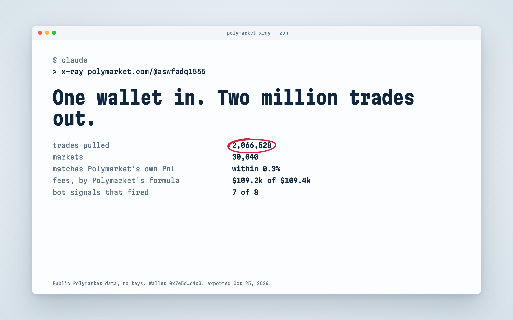
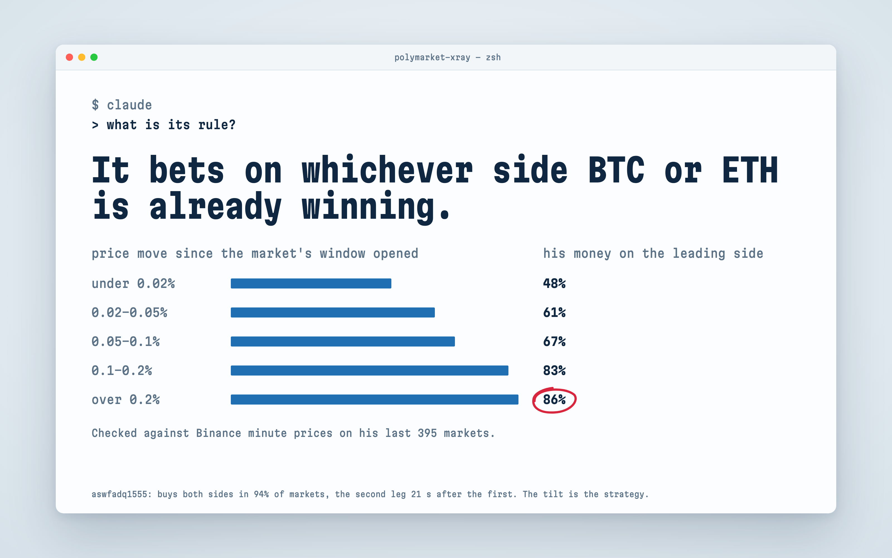
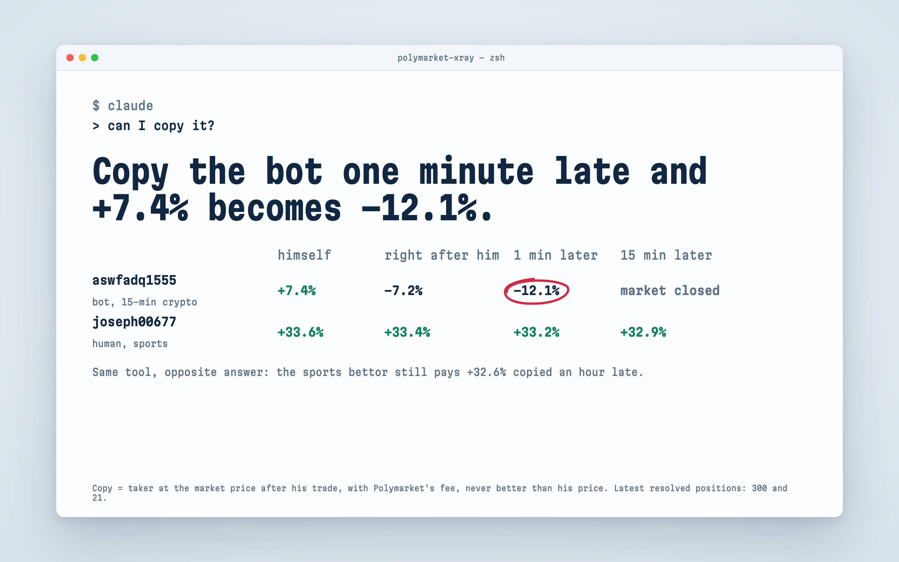
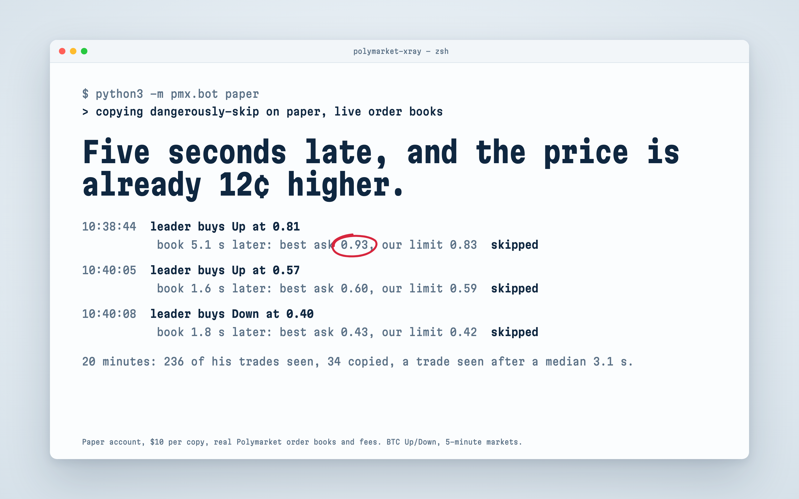

# polymarket-xray

Paste a Polymarket wallet. Get every trade it ever made, its strategy as a step-by-step recipe with the evidence behind each step, where its money really comes from, and whether copying it would still pay after a 1–60 minute delay. Then copy it on a paper account against live order books and see what a real copy would have cost.

Works as a **Claude Code plugin** ("x-ray this wallet") and as a plain **Python CLI**. Public Polymarket data only, no API keys. Nothing here places real orders.



## Install

**As a Claude Code plugin**

```
/plugin marketplace add Archive228/polymarket-xray
/plugin install polymarket-xray@polymarket-xray
```

Then ask in plain words – *"x-ray polymarket.com/@aswfadq1555"*, *"can I copy 0x7e5d…?"*, *"what's this trader's strategy?"* – or call it directly with `/polymarket-xray:xray <wallet>`. The first run asks to install the Python packages from `requirements.txt` (Python 3.9+).

**As a CLI**

```bash
git clone https://github.com/Archive228/polymarket-xray && cd polymarket-xray
python3 -m pip install -r requirements.txt
python3 -m pmx all <0x address | profile link | profile name>
```

Wallets with hundreds of thousands of trades: add `--days 30` to analyse the recent period only.

## What you get

For each wallet, in `<data folder>/wallets/<address>/` – `~/.polymarket-xray` for the plugin, `data/` in a clone, or wherever `PMX_DATA` points:

| file | what it is |
|---|---|
| `recipe.md` | **the strategy, step by step**: markets, entry window, sides, price band, order type, size, exit, pace – each with a number from the wallet's own trades and a strength (always / almost always / mostly / sometimes); a technical spec; where the money comes from; what trades cannot show and an open data source to replace it |
| `report.html` | everything with charts |
| `summary.md` | the same in plain sentences |
| `analysis.json`, `copysim.json`, `signal.json` | all numbers, machine-readable |
| `trades.csv`, `activity.csv`, `positions.csv`, `markets.csv` | the raw export |



## How it works

1. **Export.** Every fill (maker and taker), activity, positions of every status and every market, from Polymarket's public Data API, Gamma and CLOB. Day-sized windows saved as they arrive, so an interrupted export resumes.
2. **Reliability first.** The tool rebuilds the wallet's PnL from its own trades, with Polymarket's taker fee (shares × rate × p × (1 − p)), and reconciles it with Polymarket's official numbers. If they diverge, or most of the money went through merges, splits or neg-risk conversions that a trade ledger cannot see, the report says so and does not draw price-bucket conclusions.
3. **Bot or human.** Eight independent signals – both-sides quoting, gap between trades, hours per day, fixed size, number of markets, daily persistence – four or more make a bot (rules from Dennim89/polymarket-wallet-analyzer). Archetypes: market maker, basket market maker, arbitrage, HFT, whale, active trader.
4. **Strategy.** Entry-price buckets with an exact test against luck (Poisson-binomial tail, Holm correction); "buys near-certain outcomes" (carry); pairs of legs – how often it buys both sides, how fast the second leg follows, how much is locked in the pair vs the tilt to one side (from ent0n29/polybot); time to market end; PnL by outcome and week.
5. **Signal check.** For crypto Up/Down markets the tool compares every buy with Binance minute prices: how much of the money goes on the side the coin is already winning, by size of the move.
6. **Copyability.** Each of his trades is repeated right after him and 1, 5, 15 and 60 minutes later, as a taker paying the fee, at a price that is never better than his. If the market has closed by then, the copy "didn't get in". Weighted by where he actually puts his money.



## Paper copy-bot

```bash
cp bot.example.json bot.json          # leader wallet, size per copy, slippage limit, risk limits
python3 -m pmx.bot paper --config bot.json --minutes 20
python3 -m pmx.bot report --config bot.json
```

The bot polls the leader every 3 seconds, sizes each copy, and fills it on a paper account against the live order book with the market's fee and a price limit, then settles resolved markets. Everything goes into a SQLite journal: when he traded and when we saw it, what we decided and why, our price vs his. Every risk limit has a test. There is no live trading in this code: `live` refuses to run, and a test checks that paper mode never loads anything that can sign an order.



## What we found running it

On 11 wallets and five 20-minute live paper runs (October 2026):

- The copy sees the leader's trade 2–6 seconds after it (including a 3 s poll).
- On fast markets the leader's price is gone by then: a BTC 5-minute leader buys at 0.81, and when the copy checks the book 5.1 s later the best ask is 0.93.
- Who you copy matters more than how fast: a 15-minute crypto bot's +7.4% becomes −12.1% copied one minute late; a sports bettor's +33.6% is still +32.6% copied an hour late.

## Built on

| part | from | how |
|---|---|---|
| bot-or-human, archetypes, carry, position ledger (`pmx/style.py`) | [Dennim89/polymarket-wallet-analyzer](https://github.com/Dennim89/polymarket-wallet-analyzer) (MIT) | ported from Go line by line; its tests ported and passing |
| pairs of legs, complete-set lock (`pmx/pairs.py`) | [ent0n29/polybot](https://github.com/ent0n29/polybot) (MIT) | functions ported, SQL rewritten in pandas |
| order-book fill engine (`pmx/bot/fill.py`) | [agent-next/polymarket-paper-trader](https://github.com/agent-next/polymarket-paper-trader) (MIT) | vendored as is with its 109 tests |
| copy sizing (`pmx/bot/sizing.py`) | [shmlkv/polymarket-copy-trading-bot](https://github.com/shmlkv/polymarket-copy-trading-bot) (ISC) | ported from TypeScript with its tests; two bugs fixed |

Full license texts in `THIRD_PARTY_LICENSES/`. How we read 18 open-source Polymarket tools and what we took or left: [docs/credits.md](docs/credits.md). The open-source copy-bot we took sizing from was also taken apart with [REA](https://github.com/morluto/rea): [docs/copybot-teardown.md](docs/copybot-teardown.md).

## Limits

- Cancelled and unfilled orders are not public; neither are the signals a trader watches – the signal check tests one hypothesis (price move) for crypto Up/Down only.
- Copy prices come from minute price history, not historical order books (Polymarket doesn't publish them).
- Wallets that mostly trade through neg-risk conversions can be described, but their PnL can't be split by entry price.
- This is analysis of public data, not financial advice.

## Tests

```bash
python3 -m pytest tests/ -q
```

## License

MIT – see `LICENSE`. Third-party parts keep their own licenses in `THIRD_PARTY_LICENSES/`.
